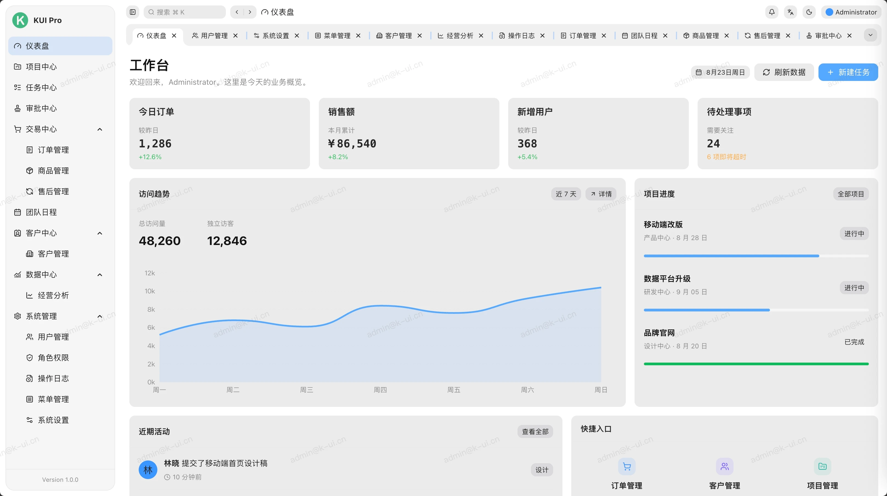
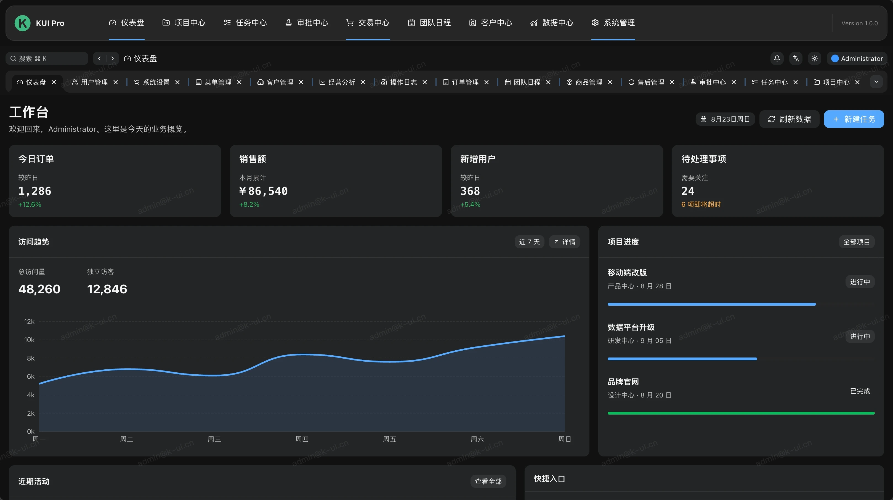
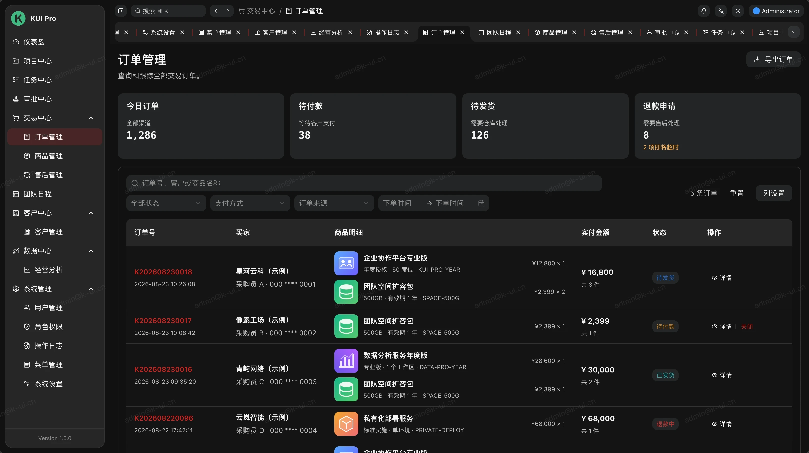

# KUI Vue Pro

> v1.0.0 · 基于 KUI Vue 的企业级中后台解决方案

基于 Vue 3、TypeScript 和 KUI Vue 的中后台解决方案。项目自带应用外壳、权限体系和一整套业务页面，全部数据来自同仓库组的 `kui-admin-api`（Cloudoll + MySQL）——没有自带数据的离线模式，起不来后端就只能看到加载失败。

## 界面预览



<table>
  <tr>
    <td width="50%"></td>
    <td width="50%"></td>
  </tr>
  <tr>
    <td align="center">深色主题与顶部导航</td>
    <td align="center">订单管理</td>
  </tr>
</table>

## 功能

- **应用外壳**：响应式工作台、深浅主题、移动端侧栏，侧栏/顶部/混合三种布局，多页签、面包屑和全局菜单搜索。
- **会话与权限**：账号密码登录、access token 过期刷新与 refresh token 轮换、服务端退出撤销；路由、菜单、按钮三层权限，`all`/`department`/`self` 三种数据范围。菜单项由服务端下发，只匹配前端已经编译好的路由，不执行远程组件地址。
- **业务页面**：订单（筛选、导出、部分发货、改价、收款结果登记、售后申请）、售后、商品、客户（列表与四张同口径统计卡片）、审批、项目与项目成员、任务列表/看板（拖拽换状态列）、日程（月历/列表两种视图）、通知中心。
- **数据**：工作台读 `/dashboard` 一次聚合（今日/本月窗口、近 7 天趋势、项目与动态面板、待办队列）；经营分析读 `/analytics`，支持 7 天/30 天/今年三种周期，含收入趋势、订单渠道、支付方式、履约漏斗和 CSV 导出，图表用 ECharts。
- **系统管理**：用户、角色、部门、菜单、操作日志（含导出）、系统设置。
- **工程化**：类型检查、Vitest 单元测试、生产构建、GitHub Actions CI，Playwright 负责构建期样式校验。

## 技术栈

- Vue 3.5 + TypeScript + Vite 8
- KUI Vue 6.2 + KUI Icons 5
- Vue Router 5（文件路由）+ Pinia 4
- ECharts 6 + vue-echarts
- big.js（金额）+ dayjs（时间窗口）
- Vitest 5 + jsdom、Playwright

## 快速创建

CLI 从 Git 仓库拉取项目，不内置独立模板；需要安装 Git，并能访问 GitHub。默认使用仓库默认分支，依赖版本和锁文件跟随仓库。

```bash
npm create kui-vue-pro@latest my-app
cd my-app
pnpm install
pnpm dev
```

也可以使用 pnpm 或 Yarn：

```bash
pnpm create kui-vue-pro my-app
yarn create kui-vue-pro my-app
```

需要固定版本时，通过 `--ref` 指定一个已存在的分支或 tag；需要换来源时用 `--repo`：

```bash
npm create kui-vue-pro@latest my-app -- --ref master
npm create kui-vue-pro@latest my-app -- --repo https://github.com/your-org/kui-vue-admin.git
```

目标目录必须为空。生成项目不保留原仓库的 Git 历史、发布工作流、CLI 包目录和 `.env` 密钥，`.env.example` 会保留；依赖不会自动安装。后端配置见[接入说明](./docs/backend-integration.md)。

## 本地开发

前端只需要 Node 和 pnpm：

```bash
git clone https://github.com/smallerqiu/kui-vue-admin.git
cd kui-vue-admin
pnpm install
cp .env.example .env.local
pnpm dev
```

开发服务默认起在 `http://localhost:7006`，`/api` 代理到 `http://127.0.0.1:9001`，对应后端项目 `../kui-admin-api`（Python 3.11+、Cloudoll 4.3.0、MySQL 8.0.16+）。后端需要先建好库（`utf8mb4` + InnoDB，时区 UTC），再按顺序执行：

```bash
kui-admin migrate
kui-admin create-admin --account admin@example.com
cloudoll start -n kui-admin
```

`create-admin` 交互式读取密码（12–128 字符），库里没有账号时初始化管理员、权限字典和菜单，已有账号时是重置密码并解锁、撤销旧会话。可选的演示数据用 `kui-admin seed-demo` 导入，只允许 `KUI_ENV=local`。健康检查是 `GET /api/health`。

登录页不预填任何凭证，账号必须由后端命令创建。登录不上时先确认三件事：账号 `enabled`、`locked_until` 是否还在 15 分钟锁定期内、前端连的是不是接口模式——后端的 `scripts/diagnose_login.py` 只做只读查询，会把这几项和数据库时区一起打出来，不输出密码哈希。

改组件库本身时可以在本地链接：`pnpm link ../kui-vue`。这时需要在 `vite.config.ts` 的 `resolve.dedupe` 里补上 `["vue", "vue-router", "pinia", "kui-icons"]`，并在 `tsconfig.app.json` 里把 `kui-vue` 指到本地源码，否则应用和组件库会各自加载一份 Vue 运行时。这两处属于本机开发环境，不随功能提交。

## 没有离线数据

页面自带的数据源已全部删除：菜单只认 `GET /navigation`，登录只认 `POST /auth/login`，经营分析、任务看板、项目成员都直接请求服务端聚合。没有开关可以切回本地数字，也没有一份"看着像真的"的样例数组留在仓库里（`tests/no-offline-source.spec.ts` 会扫全部 `src` 源码，出现 `useMock`、`VITE_USE_MOCK` 或 `@/data` 引用就红）。

因此后端是运行前置条件：`GET /api/health` 不通时，所有列表显示加载失败与重试入口，而不是编一组数字。读不到就说读不到——服务端返回 `null` 的指标显示"无法读取"，权限读不到的行不会以 0 的形式出现。

想快速把页面填满，用后端自带的 `kui-admin seed-demo`（只允许 `KUI_ENV=local`），数据进的是同一批接口，前端不需要任何模式开关。

## 环境变量

| 变量                   | 默认值                                       | 说明                                       |
| ---------------------- | -------------------------------------------- | ------------------------------------------ |
| `VITE_APP_NAME`        | `KUI Vue Pro`                                | 应用名，出现在登录页和页签                 |
| `VITE_APP_SHORT_NAME`  | `KUI Pro`                                    | 浏览器标签页标题用的简称（侧栏 logo 读的是系统设置里的简称） |
| `VITE_APP_DESCRIPTION` | `Enterprise admin solution powered by KUI Vue` | 写进 `appConfig`，当前页面未消费           |
| `VITE_API_BASE_URL`    | `/api`                                        | 请求前缀，也可以填完整地址                 |
| `VITE_SITE_URL`        | `https://admin.example.com`                  | 部署站点地址，当前页面未消费               |
| `VITE_APP_VERSION`     | `1.0.0`                                      | 侧栏底部展示的 `Version x.y.z`             |

## 权限模型

路由守卫按 `src/routers/permissions.ts::routePermissions` 那张"路径 → 权限码"表和账号实际持有的权限码判定；菜单取 `GET /navigation` 与本地已编译路由的交集，交集外的远程组件地址不会变成可执行路由。按钮级用权限指令：

```vue
<Button v-permission="'order:close'">关闭订单</Button>
```

路由块里仍然可以写 `roles`，但接口模式下它不参与判定：`applyServerMenu` 会把 `meta.roles` 清空，能不能看见这一项由服务端的菜单行和权限码决定。

登录用户支持 `all`、`department`、`self` 三种数据范围，收口全部在服务端完成——列表接口按当前账号的范围返回行集，浏览器不做行过滤。写入入口同样跟随服务端下发的权限，最终判据始终在服务端。

## 数据口径

改这些页面前值得先读几遍的几条约定，它们决定了显示和文件里的数字对不对：

- **金额**：API 传两位小数的十进制字符串。显示只有一条路径 `src/utils/common.ts::formatMoney`（字符串自己不会分组，`toLocaleString` 必须先把值转成数字，并把两位小数钉住）；写进 CSV 或提交回服务端的仍是未分组原值，因为 `1,234.00` 重新导入只剩 `1`。判零要用数值比较（`big.js`），不能用真值——`"0.00"` 是恒真的字符串，`order.freight ? … : "免运费"` 那种写法永远走不到免邮分支。
- **时间**：服务端写 naive UTC。列表按原值读（`formatDateTime` 不做时区平移，否则同一行的创建时间和最近登录时间会差 8 小时），统计窗口用 UTC 自然日和自然月，导出文件名里的日期也是 UTC 当天，可能与本地日期差一天。
- **导出**：CSV 只有一条路径 `src/utils/csv.ts`——`toCsv` 负责单元格引号（含逗号、引号、换行的值包起来、内部引号翻倍）和 `\r\n`，`downloadCsv` 负责 UTF-8 BOM（Excel 读裸 UTF-8 会把中文表头按老代码页解码）和释放 object URL。订单、操作日志、经营分析三个导出共用它。
- **失败可见**：请求层只对超时和网络错误发声，4xx/5xx 以异常抛给页面，所以每个写入入口要么把服务端原话显示在表单/弹窗内，要么经 `src/utils/report-failure.ts` 提示并保留输入；只有 401 不再重复提示，因为请求层已经在结束会话并跳转登录页。读取允许静默降级，但页面要说明降级了什么。

完整的接入状态、待接入范围和已知限制在 [docs/backend-integration.md](./docs/backend-integration.md)。

## 目录结构

```text
src/api           每个后端资源一个模块，请求封装与 CSV 导出都在这里
src/pages         文件路由；(admin) 是带应用外壳的分组，业务页按交易中心/客户中心/数据中心/系统管理摆放
src/routers       路由守卫、权限判断、服务端菜单、侧栏分组标题
src/stores        会话、偏好、主题、页签、通知
src/composables   use-resource-page、use-remote-data、use-pane-activate
src/components    business / charts / system 三组，外加代码与 JSON/YAML 预览
src/utils         request（401 轮换与重放）、auth、common、csv、report-failure、share
src/directives    v-permission
src/lang          中英文案
tests             Vitest 单元测试与源码扫描守卫
e2e               Playwright 用例与构建期样式校验
packages          create-kui-vue-pro CLI
```

## 质量检查

```bash
pnpm check      # 类型检查 + 单元测试
pnpm test       # vitest run
pnpm build      # vue-tsc -b && vite build
pnpm test:e2e   # 自动起 127.0.0.1:7007 的开发服务，用系统 Chrome 执行
```

单元测试目前 34 个文件、253 例，跑在 jsdom 上：页面用例挂载的是真实页面组件，Kui 控件按需要注册轻量替身，所以屏幕上的文案、发出的请求参数、确认之后的重读都在断言范围内。收口类的改动另有源码扫描守卫（`tests/format.spec.ts` 扫模板里每一行 `¥` 是否走 `formatMoney`，`tests/csv.spec.ts` 扫有没有模块绕开 `src/utils/csv.ts` 自己拼 CSV，`tests/no-offline-source.spec.ts` 扫有没有模块重新自带数据源或模式开关），因为多数页面没有运行时用例，光靠行为测试挡不住"某处又写回原始字符串"。

E2E 里的 `e2e/app.spec.ts` 需要一台真实后端和一个库里存在的账号，账号密码从 `KUI_E2E_ACCOUNT` / `KUI_E2E_PASSWORD` 读取，两个变量缺一个就跳过而不是失败；`e2e/theme-css.spec.ts` 是构建期的样式校验，不依赖后端。`pnpm format` 需要自行安装 prettier，它没有列在依赖里。

## 部署

构建产物在 `dist`：

```bash
pnpm build
```

仓库提供了 [Dockerfile](./Dockerfile) 和 [Nginx 配置](./deploy/nginx.conf)，Nginx 已包含 SPA history fallback。后端默认不放跨域，生产环境请把 `/api/` 反代到实际后端服务，与前端保持同源。

上线前建议：使用 HTTPS、由后端签发短期 access token 和可轮换 refresh token，并在服务端再次校验角色、权限与数据范围。

## 在线预览与版本

- 组件库文档：<https://vue.k-ui.cn/guide/pro>
- 在线预览：<https://admin.k-ui.cn>
- 当前版本：`1.0.0`
- 更新记录：[CHANGELOG.md](./CHANGELOG.md)
